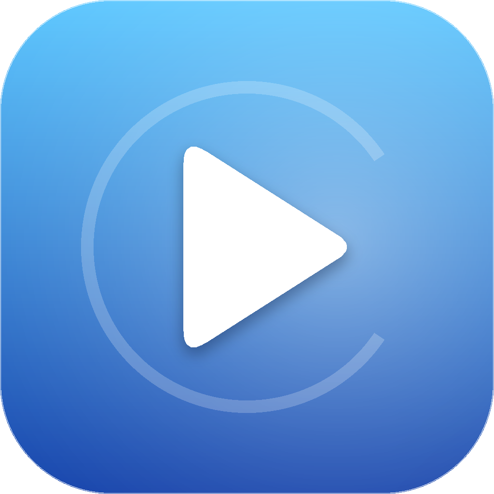
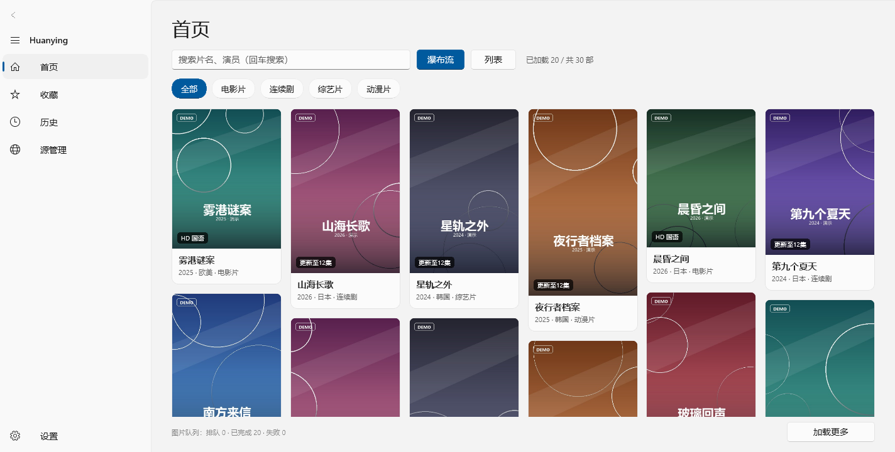
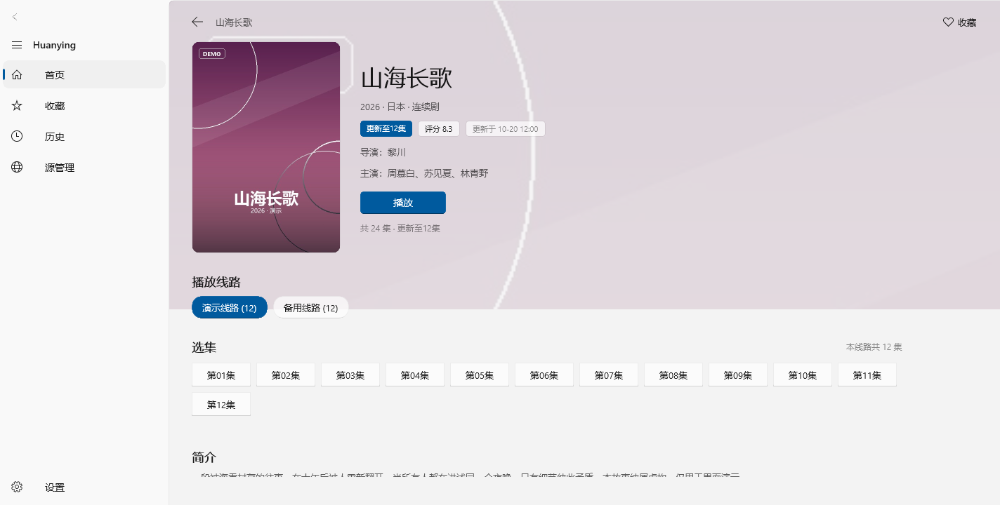
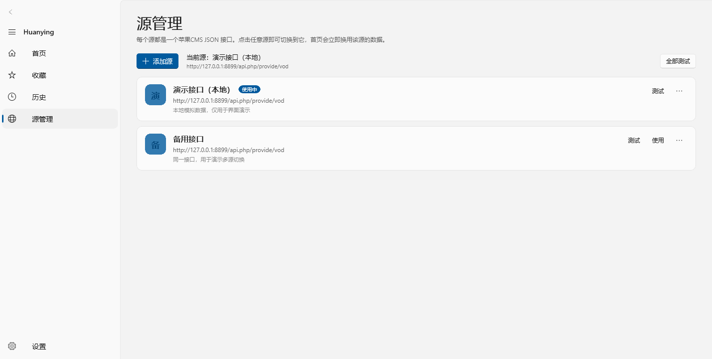
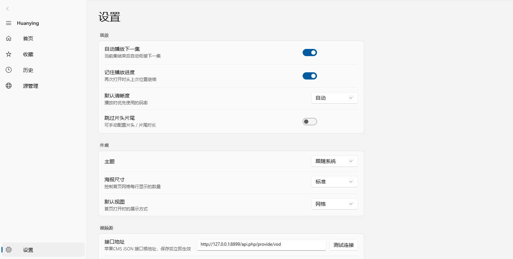

<p align="center">
  
</p>

<h1 align="center">Huanying</h1>

<p align="center">
  <b>一个 WinUI 3 的桌面影片浏览与播放客户端</b><br />
  macOS 风格侧边栏 · 瀑布流海报墙 · 自绘播放器控制层
</p>

<p align="center">
  <a href="../../releases/latest"><b>⬇ 下载最新版本</b></a>
</p>



> 截图中的片名与海报均为本地生成的演示数据，与任何真实影视作品无关。

---

## 特性

**浏览**

- **瀑布流海报墙** —— 卡片高度由海报真实比例决定，最短列优先摆放，滚到底部自动续页
- **分类吸顶** —— 整页只有一个滚动体，向上滚动时标题 / 搜索 / 继续观看随内容一起滚走，
  分类胶囊到达视口顶部后由浮层副本接管（贴边、带分隔线），换分类也停在这个位置不回弹；
  横向滚动位置、选中态在两份胶囊之间双向同步
- **队列式图片加载** —— 全局并发上限 3、同一 URL 合并请求、内存 LRU + 磁盘缓存；进可视区才下载、离开即取消、解码后淡入
- **WebP 兜底解码** —— 资源站海报大量是 WebP，系统 WIC 缺解码器时自动改用 SkiaSharp 转码，不再白板
- **多源聚合搜索** —— 一次关键词并行查多个源，结果按「片名 + 年份」合并去重；
  卡片右上角标注来源（多源命中显示「源A 等3源」，悬停看全部来源），点进去自动用对应源查详情；
  顶栏可临时勾选参与搜索的源，单个源超时或报错不影响其他源出结果
- **地区 / 年份 / 排序筛选** —— 分类胶囊下方的三个下拉直接映射苹果CMS 的 `area` / `year` / `by` 参数
  （最新、最热、评分），筛选条件会写在「筛选中：大陆 · 2025 · 评分」提示里，一键清除
- **继续观看** —— 首页顶部按本地历史列出最近 10 部没看完的片，海报底部带进度条，
  点一下自动拉详情取分集地址、带着上次的位置直接进播放页

**播放**

- HLS / m3u8 直接播放，Media Foundation 自动选择硬件或软件解码
- **音轨切换** —— m3u8 / 容器声明了多条音轨（国粤双语、多语种）时底部出现「音轨 N/M」，
  菜单里按语言、声道、编码列出每条轨道，选中即切换，不用换线路
- **清晰度切换** —— 解析主播放列表里的全部 `EXT-X-STREAM-INF`，按 4K / 1080p / 720p 列出可选档位；
  切换时记住当前位置重开同一集，选择会被记住（下次同一片源自动选回这一档）
- 自绘控制层：拖拽进度（左右 90 秒/屏宽）、左半屏调亮度、右半屏调音量、双击全屏、3.6 秒自动隐藏
- **音量绑定系统音量** —— 滑块 / 拖动 / 静音键改的都是系统主音量（Core Audio `IAudioEndpointVolume`），
  键盘音量键、任务栏滑块、系统音量弹窗与界面实时互相跟随
- **全屏不含侧边栏** —— 进全屏自动收掉左侧导航与页头，画面真正铺满；退出全屏原样还原
- **播放时不休眠、不息屏** —— 播放 / 缓冲期间用 `SetThreadExecutionState` 同时申请「系统不休眠」与
  「显示器常亮」，暂停、播完、离开播放页立即归还给系统
- 快捷键 `Space`（暂停 / 继续）/ `←` `→`（快退 / 快进 5 秒）/ `↑` `↓` / `F` / `M` / `I` / `J`（跳过片头片尾）/
  `C`（字幕字号）/ `S`（截图）/ `F1` 或 `?`（快捷键说明）/ `Esc`；
  焦点始终收在播放页，控制栏按钮与滑块都不接受焦点，所以方向键只做快进快退，
  不会跑去改音量、挪进度或把焦点甩到别的控件上
- **快捷键说明浮层** —— `F1` / `?` 或底栏「⋯ → 快捷键说明」弹出完整键位表，`Esc` 逐级关闭
- **截图当前画面** —— `S` 或「⋯ → 截图」，用 `RenderTargetBitmap` + SkiaSharp 存成 PNG
  到「图片\Huanying」（含字幕与控制层）；若显卡走硬件叠加导致视频层截成纯色，会明确提示只存到了界面层
- 倍速 0.5–2.0×、画中画、选集抽屉、下一集 5 秒倒计时自动连播、断点续播
- **视频信息面板** —— 分辨率、编码、帧率、码率、音频布局、缓冲区间、解码链路，一眼看清当前流用了什么
- **跳过片头 / 片尾** —— 详情页按影片设置片头与片尾秒数，播放到对应位置自动浮现「跳过」按钮，
  底部「跳过」菜单与 `J` 键也能随时手动跳过
- **字幕支持** —— 自动探测 m3u8 里声明的字幕轨并加载，也可手动打开本地 `.srt` / `.vtt` 或输入字幕地址；
  字幕自绘渲染在画面下方，`C` 键切换字号（小 / 中 / 大）

**管理**

- **多源管理** —— 增删改查、连通性测试、一键切换，切换后首页立即换数据
- **并发测活** —— 一次最多同时测 4 个源（串行测二十多个源要等一两分钟，并发通常十几秒），
  每个源显示状态点（绿 = 可用 / 橙 = 可用但慢 / 红 = 不可用）与实测耗时；
  「按延迟排序」把可用且快的源排到最前面
- **订阅导入** —— 一个订阅链接批量添加源：支持 JSON 数组（`name` + `api`/`url`）、每行一个地址、
  以及 Base64 编码的列表；重复地址自动跳过，导入的源可随时「更新订阅」按订阅内容刷新
- **JSON 文件导入** —— 「导入 JSON」按钮选一个本地 `.json` / `.txt`，同样支持上面那些格式；
  仓库根目录的 [`sources.example.json`](sources.example.json) 是一份带字段说明的示例源列表
  （本地演示源 + 社区公开采集接口 + 补充接口），可直接导入试效果
- 收藏 / 观看历史 / 播放进度本地持久化
- 设置页：SNI 静默回退开关已接入；播放与外观两组开关是界面预留，逻辑尚未接线

## 截图

| 详情页 | 源管理 | 设置 |
| --- | --- | --- |
|  |  |  |

## 下载与安装

到 [Releases](../../releases/latest) 页下载，两个包都**自带 Windows App SDK**（`WindowsAppSDKSelfContained=true`），
区别只在 .NET 运行时是否打进去：

| 包 | 下载 | 解压后 | 需要安装 |
| --- | --- | --- | --- |
| `Huanying-<版本>-win-x64-self-contained.zip` | ~74 MB | ~185 MB | 无需安装，**解压即用** |
| `Huanying-<版本>-win-x64-framework-dependent.zip` | ~38 MB | ~108 MB | 只需 [.NET 10 Desktop Runtime](https://dotnet.microsoft.com/download/dotnet/10.0) |

两者都**不需要**额外安装 Windows App SDK 1.8 Runtime —— WinUI 的运行时组件已经在包里了。
解压后直接运行 `Huanying.exe`。这不是 MSIX 安装包，不写注册表，删掉文件夹即卸载。

**系统要求**：Windows 10 19041（2004）及以上 / Windows 11，x64。

## 首次运行：添加视频源

**应用本身不内置任何视频接口，第一次启动时源列表是空的。**

启动后首页会提示「还没有视频源」。三种添加方式：

1. 点「去添加视频源」或左侧「源管理」，填入你自己的苹果CMS（MacCMS V10）JSON 接口根地址；
2. 「订阅导入」粘一个订阅链接批量添加；
3. 「导入 JSON」选一份本地源列表文件 —— 仓库根目录的
   [`sources.example.json`](sources.example.json) 就是一份现成的（本地演示源 + 社区公开采集接口 + 补充接口）。

接口地址形如：

```
https://你的域名/api.php/provide/vod
```

接口需支持这几个请求（这是该 CMS 的标准约定）：

| 用途 | 请求 |
| --- | --- |
| 列表（含海报等完整字段） | `?ac=detail&pg=1` |
| 按分类 | `?ac=detail&pg=1&t=13` |
| 关键词搜索 | `?ac=detail&wd=关键词` |
| 详情 | `?ac=detail&ids=88480` |
| 分类表 | `?ac=list`（只有这个响应带 `class` 数组） |

配置保存在 `%LOCALAPPDATA%\Huanying\settings.json`，也可以直接编辑。

有多个源时，可以一次导入而不是逐个添加：把接口地址写成 JSON 列表（仓库根目录的
[`sources.example.json`](sources.example.json) 就是一份现成的示例：本地演示源、社区公开采集接口、
以及几个补充接口），然后在「源管理 → 导入 JSON」里选中它即可；订阅链接导入也支持同样的格式。

> 示例文件里的第三方采集接口来自公开列表（[cms-player/vod-source](https://github.com/cms-player/vod-source)），
> 仅作格式与连通性参考。这些站点的可用性、内容与速度由对方决定，本项目**不提供、不存储、不分发任何影片资源**，
> 也不保证它们长期有效；是否需要使用请自行判断是否符合当地法律法规与你所在网络的使用规定。

## 构建

需要 **.NET SDK 10.0.4xx**（项目目标框架 `net10.0-windows10.0.19041.0`）。

```bash
# 调试运行
dotnet build Huanying.csproj
dotnet run --project Huanying.csproj

# 免安装版（自带 .NET 运行时；Windows App SDK 两个版本都自带）
dotnet publish Huanying.csproj -c Release -r win-x64 \
  --self-contained true -p:WindowsAppSDKSelfContained=true -o publish/self-contained

# 依赖 .NET 运行时版（仍需目标机装 .NET 10 Desktop Runtime，但不装 Windows App SDK Runtime）
dotnet publish Huanying.csproj -c Release -r win-x64 \
  --self-contained false -p:WindowsAppSDKSelfContained=true -o publish/framework-dependent
```

推一个 tag（如 `v0.1.1`）上去，[`.github/workflows/release.yml`](.github/workflows/release.yml)
会从 tag 解析版本号（`v0.1.1` → `0.1.1`），用 `-p:Version` 覆盖进编译，
再自动编译上面两个变体、各打一个 `Huanying-<版本>-win-x64-<flavor>.zip`，并创建对应 Release。

版本号只有 tag 这一个来源，代码里没有写死的版本字符串：`Huanying.csproj` 里的 `<Version>`
只是本地直接 `dotnet build` 时的兜底，应用「设置 → 关于」显示的是编译产物里的程序集元数据
（`AssemblyInformationalVersion`），所以发布出去装的是哪个 tag，关于页就显示哪个版本。

两个包打包前都会做一次精简：删掉本应用用不到的 Windows AI / ONNX 运行时（`onnxruntime.dll`、`DirectML.dll`
等，约 39 MB），语言资源只保留 `en-us` / `en-GB` / `zh-CN` / `zh-TW`（其余 70 余套回退到 `en-us`，约 42 MB）。

## 工程要点

几处踩过的坑，改配置前值得先看：

| 属性 | 值 | 原因 |
| --- | --- | --- |
| `TargetFramework` | `net10.0-windows10.0.19041.0` | Windows App SDK 1.6 不认 .NET 10，必须用 1.8 |
| `WindowsPackageType` | `None` | 非打包（unpackaged），不生成 MSIX；**别把 `Package.appxmanifest` 塞给 `<ApplicationManifest>`**，那是包清单，会报 "root element should be `<assembly/>`" |
| `RuntimeIdentifier` | `win-x64` | 自包含模式必须显式指定架构 |
| `SelfContained` | 两个变体分别 `true` / `false` | 决定 .NET 运行时是否随包分发 |
| `WindowsAppSDKSelfContained` | 两个变体都是 `true` | WinUI 运行时随包分发，用户不必预装 Windows App SDK Runtime |
| `Microsoft.Windows.SDK.BuildTools` | `10.0.26100.4654` | 低于此版本会触发 NU1605 包降级错误 |

其他约束：

- 自定义类型不能直接写在 `App.xaml` 里，必须放独立的 `ResourceDictionary`，否则报 WMC0001
- 挂 `KeyboardAccelerator` 的元素默认会把加速键做成**悬停提示**（鼠标移上去冒出一条「空格」气泡）；
  不想要就设 `KeyboardAcceleratorPlacementMode="Hidden"`，快捷键照样能用
- 播放器按钮必须 `IsTabStop="False"` + `AllowFocusOnInteraction="False"`，否则点过某个按钮后按空格会
  **重新点它**（比如又把全屏切回去），而不是暂停
- 快捷键不能只靠 `KeyboardAccelerator`：加速键只在焦点元素**没处理**该按键时才会被调用，焦点一旦
  落到进度条 / 音量条 / 选集列表上，`←` `→` 就被它们吃掉（进度跳一格、音量改一格，或者焦点被挪走）。
  现在播放页 `IsTabStop="True"` 并在 `Loaded` 时 `Focus()` 自己，播放器内所有按钮与滑块都不接受焦点，
  再加上根部 `PreviewKeyDown` 抢先拦截并 `Handled = true`，方向键只做快进快退
- 防息屏要用 `SetThreadExecutionState(ES_CONTINUOUS | ES_SYSTEM_REQUIRED | ES_DISPLAY_REQUIRED)`：
  `DisplayRequest` 只挡息屏不挡系统睡眠，而且这个 API 是**按线程**生效，必须在 UI 线程调用
- 音量走系统主音量后，`MediaPlayer.Volume` 要固定在 1，不然两边各降一半；`IAudioEndpointVolume`
  的回调在 COM 线程上触发，回写界面必须切回 UI 线程
- `ThemeResource` 只能用真实存在的键；写错（例如 `FillColorAlterativeBaseBrush`）会让应用启动即崩 `0xC000027B`
- `NavigationViewItemPresenter` 是内部类型，不能用于自定义 `ControlTemplate`，只能改 `Setter`
- `MediaPlaybackSession` 的缓冲结束事件叫 `BufferingEnded`，没有 `BufferingCompleted`
- `dotnet publish` **不会**自动搬运应用自己的 `Huanying.pri`（XAML 资源包），必须用 `AfterTargets="Publish"` 的 target 补拷，否则打包后的 exe 一启动就报 `Cannot locate resource from 'ms-appx:///MainWindow.xaml'`
- 要读编码参数必须用 `MediaPlaybackItem` 包一层 `MediaSource`；直接给 `MediaSource` 拿不到 `VideoTracks`
- `BufferingProgress` / `CanSeek` / `IsProtected` 在 Opening 阶段会抛 `COMException`，信息面板每行都要独立容错

### 网络

部分网络会按 TLS SNI 阻断资源站域名（TCP 通、握手无响应）。为此内置了一条
**SNI 静默直连**回退通道：不发送 SNI 完成握手，HTTP 层仍带正确 `Host` 头，带 4 次重试。
仅在常规通道失败时启用，可在设置里关闭。

本机地址（`127.0.0.1` / `localhost`）会自动绕过系统代理，避免本地接口被代理拦成 502。

## 自检开关

排查问题时可用环境变量触发内置自检（日志写到 `%TEMP%\Huanying-crash.log`）：

| 变量 | 作用 |
| --- | --- |
| `HY_SMOKE=1` | 逐页实例化，验证 XAML 能否解析 |
| `HY_APITEST=1` | 请求一次当前接口并记录结果 |
| `HY_NAV=home` / `shell:detail:1002` / `play` | 真实导航到指定页面并打印页面状态 |
| `HY_INFO=1` | 播放页打开「视频信息」面板并输出其内容 |
| `HY_FS=1` | 播放页切一次全屏、截图、再还原，并打印外壳（侧边栏）收起状态 |
| `HY_VOL=<0-100>` | 把音量设到指定百分比再回读，验证系统音量绑定是否生效 |
| `HY_AWAKE=1` | 申请一次「不休眠 / 不息屏」再归还，验证常亮接口是否生效 |
| `HY_KEYTEST=1` | 逐个走一遍 `←` `→` `↑` `↓` `空格` 与一个无关键，打印各自的处理结果 |
| `HY_SUB=<订阅链接>` | 启动时导入一次订阅并打印解析 / 去重结果 |
| `HY_AGGTEST=<关键词>` | 并行查全部已配置源，打印每个源的结果与合并去重后的命中（首页也会自动开启聚合搜索） |
| `HY_SKIPTEST=1` | 跳过片头片尾的存储往返自检（写入 → 落盘 → 更新 → 删除，用临时 ID 不碰真实数据） |
| `HY_JSON=<文件路径>` | 解析并导入一份 JSON / 文本源列表，打印每条结果与去重情况（`HY_JSON=1` 用仓库自带的 `sources.example.json`） |
| `HY_SHOT=<路径>` | 用 `RenderTargetBitmap` 把窗口截成 PNG |
| `HY_FILTERTEST=1` | 筛选参数拼接与 m3u8 多码率变体解析自检（纯逻辑，不联网） |
| `HY_FILTER=<地区,年份,排序>` | 在首页真实设置三个筛选下拉并重新加载（如 `大陆,2025,score`），打印结果卡片数 |
| `HY_CONTINUE=1` | 模拟点第一张「继续观看」卡片，验证 拉详情 → 带进度进播放页 |
| `HY_DETAILSCROLL=1` | 详情页滚到「相似推荐」并截图 |
| `HY_STICKY=<像素[,像素]>` | 首页依次滚到这些纵向偏移，打印分类条吸顶状态（`show` / `anchor` / `offset`）并截图 |
| `HY_STICKYCLICK=<索引>` | 点吸顶条上的第 N 个分类胶囊，验证 吸顶状态下换分类不会回弹到顶部 |
| `HY_LIST=1` / `0` | 首页切到列表视图 / 瀑布流视图并截图 |
| `HY_MENUTEST=1` | 播放页打印音轨菜单与清晰度菜单里实际有哪些条目 |
| `HY_HELPTEST=1` | 播放页打开快捷键面板、读行数、再关闭 |
| `HY_SHOTFRAME=<路径>` | 用播放页自己的截图功能存 PNG（验证 `S` 键那条通路） |
| `HY_PROBETEST=1` | 并发测活全部源，打印每个源的等级 / 耗时，再按延迟排序 |

`tools/` 下还有三个脚本，用于生成图标与 README 样板图：

```bash
python tools/make_icon.py           # Assets/Huanying.ico + branding/icon-1024.png
python tools/make_demo_posters.py   # 生成 30 张虚构演示海报
python tools/mock_vod_server.py     # 本地演示接口（127.0.0.1:8899）
                                    # 另带 /sub.json 与 /sub.txt 两个订阅样例，验证订阅导入用
                                    # /hls/<片>/<集>.m3u8 返回带 3 档码率 + 1 条字幕轨的主播放列表
                                    # （只有播放列表没有分片，用来验证清晰度 / 音轨 / 字幕解析，播放会失败）
                                    # 支持 area / year / by 参数，可直接验证首页筛选与排序
```

配合 `HY_SHOT` 与本地演示接口，就能复现 README 里的全部截图。

## 目录结构

```
Huanying/
├─ App.xaml(.cs)            应用入口、自检开关
├─ MainWindow.xaml(.cs)     窗口与图标
├─ Views/                   ShellPage / HomePage / ShowDetailPage / PlayerPage
│                           FavoritesPage / HistoryPage / SourceListPage / SettingsPage
├─ Controls/                MasonryLayout（瀑布流布局）、QueuedImage（队列图片控件）
├─ Models/                  VOD 数据模型、海报卡片、本地库、视频源
├─ Services/                VodApiService / ImageQueue / SourceStore / LibraryStore
│                           SubscriptionService / SystemVolumeService / KeepAwakeService / AppInfo
│                           AppSettings / HlsPlaylist / SniProbe / SystemVolumeService
├─ Converters/  Styles/     XAML 转换器与主题样式
├─ Assets/                  Huanying.ico、Huanying.png
├─ branding/                1024px 图标
└─ tools/                   图标与演示数据脚本
```

## 免责声明

本项目是一个**客户端界面程序**，只负责展示与播放。

- 不提供、不托管、不分发任何影片、剧集或其它受版权保护的内容
- 不内置任何第三方接口地址，所有数据均来自使用者自行配置的接口
- 使用者需自行确保所配置的接口与观看的内容符合当地法律法规

代码按原样提供，不附任何形式的担保。
