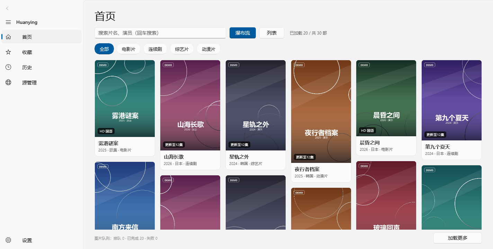
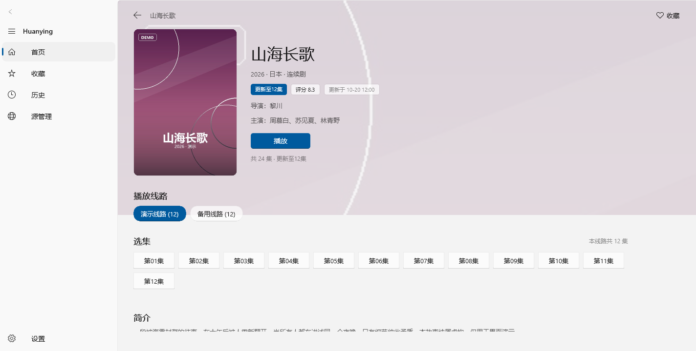
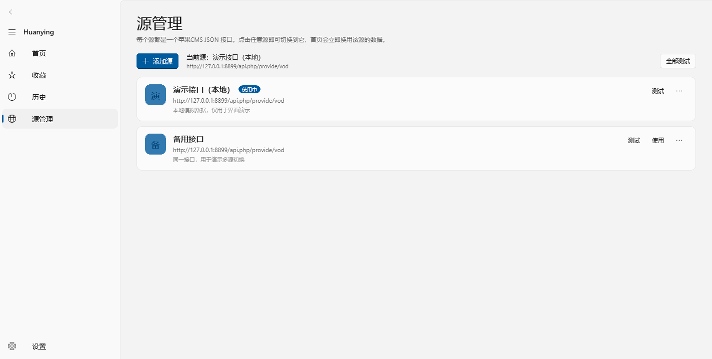
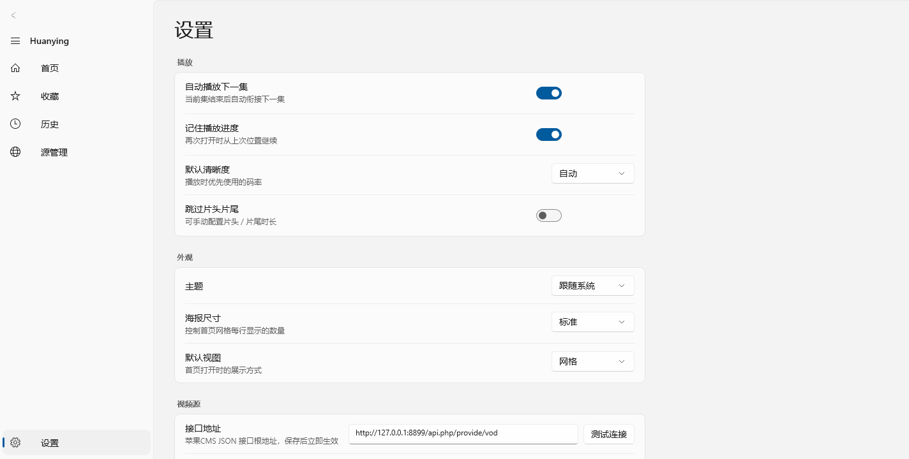

<p align="center">
  
</p>

<h1 align="center">Huanying</h1>

<p align="center">
  <b>一个 WinUI 3 的桌面影片浏览与播放客户端</b><br />
  macOS 风格侧边栏 · 瀑布流海报墙 · 自绘播放器控制层
</p>

<p align="center">
  <a href="../../releases/latest"><b>⬇ 下载最新版本</b></a>
</p>



> 截图中的片名与海报均为本地生成的演示数据，与任何真实影视作品无关。

---

## 特性

**浏览**

- **瀑布流海报墙** —— 卡片高度由海报真实比例决定，最短列优先摆放，滚到底部自动续页
- **队列式图片加载** —— 全局并发上限 3、同一 URL 合并请求、内存 LRU + 磁盘缓存；进可视区才下载、离开即取消、解码后淡入
- **WebP 兜底解码** —— 资源站海报大量是 WebP，系统 WIC 缺解码器时自动改用 SkiaSharp 转码，不再白板

**播放**

- HLS / m3u8 直接播放，Media Foundation 自动选择硬件或软件解码
- 自绘控制层：拖拽进度（左右 90 秒/屏宽）、左半屏调亮度、右半屏调音量、双击全屏、3.6 秒自动隐藏
- 快捷键 `Space` / `←` `→` / `↑` `↓` / `F` / `M` / `I` / `Esc`
- 倍速 0.5–2.0×、画中画、选集抽屉、下一集 5 秒倒计时自动连播、断点续播
- **视频信息面板** —— 分辨率、编码、帧率、码率、音频布局、缓冲区间、解码链路，一眼看清当前流用了什么

**管理**

- **多源管理** —— 增删改查、连通性测试、一键切换，切换后首页立即换数据
- 收藏 / 观看历史 / 播放进度本地持久化
- 设置项：自动连播、记忆进度、默认清晰度、主题、海报尺寸、默认视图、SNI 回退开关

## 截图

| 详情页 | 源管理 | 设置 |
| --- | --- | --- |
|  |  |  |

## 下载与安装

到 [Releases](../../releases/latest) 页下载，两个包内容一致，区别只在运行时是否自带：

| 包 | 体积 | 需要安装 |
| --- | --- | --- |
| `Huanying-<版本>-win-x64-self-contained.zip` | 大 | 无需安装，**解压即用** |
| `Huanying-<版本>-win-x64-framework-dependent.zip` | 小 | [.NET 10 Desktop Runtime](https://dotnet.microsoft.com/download/dotnet/10.0) + [Windows App SDK 1.8 Runtime](https://learn.microsoft.com/windows/apps/windows-app-sdk/downloads) |

解压后直接运行 `Huanying.exe`。这不是 MSIX 安装包，不写注册表，删掉文件夹即卸载。

**系统要求**：Windows 10 19041（2004）及以上 / Windows 11，x64。

## 首次运行：添加视频源

**本项目不内置、不附带、不推荐任何影片接口地址。**

启动后首页会提示「还没有视频源」。点「去添加视频源」或左侧「源管理」，填入你自己的
苹果CMS（MacCMS V10）JSON 接口根地址：

```
https://你的域名/api.php/provide/vod
```

接口需支持这几个请求（这是该 CMS 的标准约定）：

| 用途 | 请求 |
| --- | --- |
| 列表（含海报等完整字段） | `?ac=detail&pg=1` |
| 按分类 | `?ac=detail&pg=1&t=13` |
| 关键词搜索 | `?ac=detail&wd=关键词` |
| 详情 | `?ac=detail&ids=88480` |
| 分类表 | `?ac=list`（只有这个响应带 `class` 数组） |

配置保存在 `%LOCALAPPDATA%\Huanying\settings.json`，也可以直接编辑。

## 构建

需要 **.NET SDK 10.0.4xx**（项目目标框架 `net10.0-windows10.0.19041.0`）。

```bash
# 调试运行
dotnet build Huanying.csproj
dotnet run --project Huanying.csproj

# 免安装版（自带 .NET 与 Windows App SDK）
dotnet publish Huanying.csproj -c Release -r win-x64 \
  --self-contained true -p:WindowsAppSDKSelfContained=true -o publish/self-contained

# 依赖运行时版
dotnet publish Huanying.csproj -c Release -r win-x64 \
  --self-contained false -p:WindowsAppSDKSelfContained=false -o publish/framework-dependent
```

推一个 tag（如 `v1.0.0`）上去，[`.github/workflows/release.yml`](.github/workflows/release.yml)
会自动编译上面两个变体、各打一个 `Huanying-<版本>-win-x64-<flavor>.zip`，并创建 Release。

## 工程要点

几处踩过的坑，改配置前值得先看：

| 属性 | 值 | 原因 |
| --- | --- | --- |
| `TargetFramework` | `net10.0-windows10.0.19041.0` | Windows App SDK 1.6 不认 .NET 10，必须用 1.8 |
| `WindowsPackageType` | `None` | 非打包（unpackaged），不生成 MSIX；**别把 `Package.appxmanifest` 塞给 `<ApplicationManifest>`**，那是包清单，会报 "root element should be `<assembly/>`" |
| `RuntimeIdentifier` | `win-x64` | 自包含模式必须显式指定架构 |
| `SelfContained` / `WindowsAppSDKSelfContained` | 由 CI 覆盖 | 决定「依赖运行时」还是「免安装」两个变体 |
| `Microsoft.Windows.SDK.BuildTools` | `10.0.26100.4654` | 低于此版本会触发 NU1605 包降级错误 |

其他约束：

- 自定义类型不能直接写在 `App.xaml` 里，必须放独立的 `ResourceDictionary`，否则报 WMC0001
- `ThemeResource` 只能用真实存在的键；写错（例如 `FillColorAlterativeBaseBrush`）会让应用启动即崩 `0xC000027B`
- `NavigationViewItemPresenter` 是内部类型，不能用于自定义 `ControlTemplate`，只能改 `Setter`
- `MediaPlaybackSession` 的缓冲结束事件叫 `BufferingEnded`，没有 `BufferingCompleted`
- `dotnet publish` **不会**自动搬运应用自己的 `Huanying.pri`（XAML 资源包），必须用 `AfterTargets="Publish"` 的 target 补拷，否则打包后的 exe 一启动就报 `Cannot locate resource from 'ms-appx:///MainWindow.xaml'`
- 要读编码参数必须用 `MediaPlaybackItem` 包一层 `MediaSource`；直接给 `MediaSource` 拿不到 `VideoTracks`
- `BufferingProgress` / `CanSeek` / `IsProtected` 在 Opening 阶段会抛 `COMException`，信息面板每行都要独立容错

### 网络

部分网络会按 TLS SNI 阻断资源站域名（TCP 通、握手无响应）。为此内置了一条
**SNI 静默直连**回退通道：不发送 SNI 完成握手，HTTP 层仍带正确 `Host` 头，带 4 次重试。
仅在常规通道失败时启用，可在设置里关闭。

本机地址（`127.0.0.1` / `localhost`）会自动绕过系统代理，避免本地接口被代理拦成 502。

## 自检开关

排查问题时可用环境变量触发内置自检（日志写到 `%TEMP%\Huanying-crash.log`）：

| 变量 | 作用 |
| --- | --- |
| `HY_SMOKE=1` | 逐页实例化，验证 XAML 能否解析 |
| `HY_APITEST=1` | 请求一次当前接口并记录结果 |
| `HY_NAV=home` / `shell:detail:1002` / `play` | 真实导航到指定页面并打印页面状态 |
| `HY_INFO=1` | 播放页打开「视频信息」面板并输出其内容 |
| `HY_SHOT=<路径>` | 用 `RenderTargetBitmap` 把窗口截成 PNG |

`tools/` 下还有三个脚本，用于生成图标与 README 样板图：

```bash
python tools/make_icon.py           # Assets/Huanying.ico + branding/icon-1024.png
python tools/make_demo_posters.py   # 生成 30 张虚构演示海报
python tools/mock_vod_server.py     # 本地演示接口（127.0.0.1:8899）
```

配合 `HY_SHOT` 与本地演示接口，就能复现 README 里的全部截图。

## 目录结构

```
Huanying/
├─ App.xaml(.cs)            应用入口、自检开关
├─ MainWindow.xaml(.cs)     窗口与图标
├─ Views/                   ShellPage / HomePage / ShowDetailPage / PlayerPage
│                           FavoritesPage / HistoryPage / SourceListPage / SettingsPage
├─ Controls/                MasonryLayout（瀑布流布局）、QueuedImage（队列图片控件）
├─ Models/                  VOD 数据模型、海报卡片、本地库、视频源
├─ Services/                VodApiService / ImageQueue / SourceStore / LibraryStore
│                           AppSettings / HlsPlaylist / SniProbe
├─ Converters/  Styles/     XAML 转换器与主题样式
├─ Assets/                  Huanying.ico、Huanying.png
├─ branding/                1024px 图标
└─ tools/                   图标与演示数据脚本
```

## 免责声明

本项目是一个**客户端界面程序**，只负责展示与播放。

- 不提供、不托管、不分发任何影片、剧集或其它受版权保护的内容
- 不内置任何第三方接口地址，所有数据均来自使用者自行配置的接口
- 使用者需自行确保所配置的接口与观看的内容符合当地法律法规

代码按原样提供，不附任何形式的担保。
